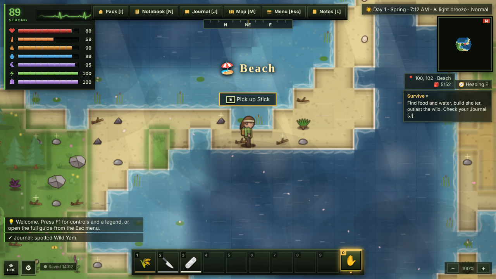

# Wildroot

A 2D survival game that runs in the browser. Forage, craft, build, farm and outlast the wild. One HTML file, no install, no account, no tracking.



Version **4.18**.

## Publish it on GitHub Pages (about 5 minutes)

1. Create a new repository on GitHub (public, or private on a paid plan).
2. Upload everything in this folder to the repository root, including the hidden `.github` and `.nojekyll` entries. With git:
   ```
   git init -b main
   git add -A
   git commit -m "Wildroot 4.18"
   git remote add origin https://github.com/YOUR-NAME/YOUR-REPO.git
   git push -u origin main
   ```
3. In the repository open **Settings, Pages** and set **Source** to **GitHub Actions**.
4. The *Publish GitHub Pages* workflow runs on every push to `main`. When it finishes, the game is live at `https://YOUR-NAME.github.io/YOUR-REPO/`.

The page installs as an app on Android, Chrome and Edge, works offline after the first visit, and on iPhone uses Safari's Add to Home Screen.

## Build the desktop and mobile apps

The *Build apps and publish a release* workflow builds every app on GitHub's servers. Nothing needs installing on your computer.

```
git tag v4.18.0
git push origin v4.18.0
```

When it finishes (roughly 15 to 25 minutes) the **Releases** page has:

| Platform | File |
|---|---|
| Windows | `Wildroot-Windows-Setup.exe`, `Wildroot-Windows-Portable.exe` |
| macOS | `Wildroot-macOS-arm64.dmg` (Apple Silicon), `Wildroot-macOS-x64.dmg` (Intel) |
| Linux | `Wildroot-Linux.AppImage`, `Wildroot-Linux.deb` |
| Android | `Wildroot-Android.apk` |
| iPhone / iPad | `Wildroot-iOS-Simulator.zip` (test build). For real devices use Add to Home Screen, or see `docs/RELEASING.md` for TestFlight |

The in-game **Settings, Downloads** tab links to these files. On a github.io project page the repository is detected automatically. For a custom domain or a user page set it by hand in `index.html`:

```html
<meta name="wildroot-repo" content="YOUR-NAME/YOUR-REPO">
```

You can also run the workflow manually from the **Actions** tab to build without publishing.

## Run it locally

* Web: open `index.html` in a browser, or serve this folder with any static server.
* Desktop app: `npm install` then `npm start`.
* Build an installer on your own machine: `npm run dist:win`, `npm run dist:mac` or `npm run dist:linux` (each only on its own operating system).

## What is in this folder

| Path | Purpose |
|---|---|
| `index.html` | The whole game |
| `manifest.webmanifest`, `sw.js`, `icons/` | Installable web app with offline support |
| `electron/`, `package.json`, `build/` | Windows, macOS and Linux apps (Electron) |
| `capacitor.config.json`, `scripts/` | Android and iOS apps (Capacitor) |
| `.github/workflows/` | Pages publishing and release builds |
| `docs/RELEASING.md` | Signing, notarization and store notes |
| `screenshots/` | Used by the manifest and this README |

## Updating the game

Replace `index.html`, change `CACHE` in `sw.js` to a new name (for example `wildroot-v4.18b`) so installed copies refresh, and push.

## Licence

`LICENSE` is a placeholder MIT licence in the name Jeck. Change it to whatever you prefer before publishing.
